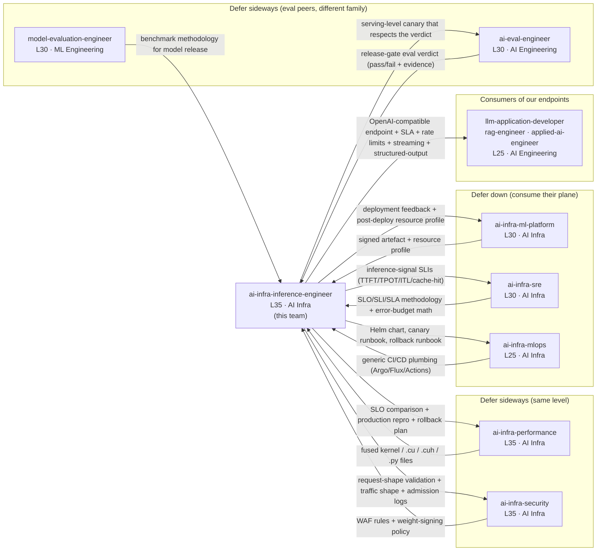

# Exercise 01 — Role Scope and Deferral Contract (Reference Solution)

Paired exercise: [`exercise-01-role-scope-and-deferral-contract.md`](../../../../ai-infra-inference-engineer-learning/lessons/mod-101-inference-engineering-position/exercises/exercise-01-role-scope-and-deferral-contract.md). Anchor chapter: [Chapter 01 — Role Scope on the Ladder](../../../../ai-infra-inference-engineer-learning/lessons/mod-101-inference-engineering-position/01-role-scope-on-the-ladder.md).

## 1. Solution overview

The exercise asks learners to turn Chapter 01's six peer boundaries into an operable routing artefact with three deliverables:

- **Artefact A** — a role-scope diagram placing `ai-infra-inference-engineer` (L35, AI Infra) at the centre and labelling each peer boundary with a single load-bearing deliverable.
- **Artefact B** — a deferral table with one row per peer or consumer track, including the eval peer boundary.
- **Artefact C** — five worked routing scenarios that resolve in ≤ 100 words each.

The worked answer below picks a *synthetic organisation* (no real company name) so the solution stays self-contained. The grading rubric is at the bottom; learners who use a different real organisation should expect *shape* parity with this answer, not row-for-row parity.

## 2. Implementation — Worked answer

### 2.1 Artefact A — Role-scope diagram

The arrows above are directional: the label describes *the thing that crosses the boundary*, not "collaboration."

### 2.2 Artefact B — Deferral table

| Peer | Level | Family | They own | We own | Routing rule | Escalation path |
|---|---|---|---|---|---|---|
| `ai-infra-performance` | L35 | AI Infra | Fused kernels, attention/GEMM paths, kernel-level performance analysis | Engine upgrade in the fleet, the SLO comparison, and the rollback plan | If the deliverable is a `.cu` / `.cuh` / `.py` kernel file, route to performance; if it is a running serving system, we keep it | Joint on-call bridge during kernel-induced regressions; otherwise `ai-infra-architect` (L40) |
| `ai-infra-ml-platform` | L30 | AI Infra | Model registry, artefact store, lineage, signing | Pulling the artefact into a serving fleet, loading it into vLLM / SGLang / TRT-LLM | If the deliverable is a registry/lineage/signing change, route to ml-platform; if it is a serving config, we keep it | ml-platform team-lead; cross-team: `ai-infra-architect` (L40) |
| `ai-infra-sre` | L30 | AI Infra | SRE methodology, SLO/SLI/SLA definitions, incident command, error-budget math | TTFT / TPOT / cache-hit as inference-specific SLIs plugged into their framework | If the deliverable is an SRE process / error-budget decision, route to SRE; if it is an inference-specific SLI definition, we keep it | Shared incident commander on cross-cutting outages |
| `ai-infra-mlops` | L25 | AI Infra | Generic CI/CD and automation plumbing | vLLM Helm chart, canary weight ramp, rollback runbook | If the deliverable is CI/CD plumbing not specific to inference, route to mlops; if it is an inference-specific rollout artefact, we keep it | mlops team-lead; `ai-infra-architect` (L40) |
| `ai-infra-security` | L35 | AI Infra | Prompt-injection defence at the API gateway, weight-signing policy, model extraction defence | OpenAI-compatible API surface, request-shape validation, tenant isolation at the inference layer | If the deliverable is a WAF / gateway / signing policy, route to security; if it is tenant isolation inside the engine, we keep it | Joint on-call bridge during security incidents touching serving |
| `ai-eval-engineer` | L30 | AI Engineering | Application-layer eval (go/no-go on model behaviour) | Serving-level canary that uses the eval verdict as a go/no-go | If the deliverable is a quality verdict for an application, route to ai-eval; if it is the canary wiring that respects the verdict, we keep it | Shared release channel |
| `model-evaluation-engineer` | L30 | ML Engineering | Benchmark methodology for model releases | Production reconciliation of benchmark deltas against serving metrics | If the deliverable is a benchmark / accuracy methodology, route to model-evaluation; if it is a serving-metric reconciliation, we keep it | ML Engineering release manager |
| AI Engineering consumers (`llm-application-developer`, `rag-engineer`, `applied-ai-engineer`) | L25 | AI Engineering | Prompt design, agent-loop logic, RAG pipeline construction | The inference endpoint, its SLA, its rate limits, its streaming semantics, its structured-output enforcement | If the deliverable is a prompt / agent / RAG change, route to the consumer team; if it is an API contract change, we keep it | Shared consumer-impact on-call rota |

### 2.3 Artefact C — Five worked routing scenarios

**Scenario 1 — "P99 TTFT doubled overnight on the chat endpoint. Monday's model swap landed on Sunday."**

Primary owner: **us** (inference platform). Supported by: `ai-infra-ml-platform` (if the swapped artefact is implicated), `ai-infra-performance` (if kernel path changed with the model). Cites row: we own the "canary weight ramp, rollback runbook," and TTFT is an inference SLI we own. Handover to peers: the exact revision of the swapped artefact + the canary report (did canary hold TTFT P99 before promotion?). Validation back from the fix: a fresh SLO comparison across the pre-swap and post-rollback (or forward-fix) build that shows TTFT P99 inside the stated target.

**Scenario 2 — "A customer reports JSON-mode responses are no longer valid JSON for ~1 % of requests."**

Primary owner: **us** (inference platform) for constrained-decoding / structured-output backend correctness. Supported by: `ai-eval-engineer` for application-layer correctness verdict. Cites row: we own "structured-output enforcement" on the endpoint; eval owns the application-quality verdict. Handover to eval: a repro set (prompt + schema + model + sampling params + output) plus the version of the Outlines/XGrammar backend. Validation back: a release-gate verdict showing the fixed build's structured-output invalid-rate at the stated threshold.

**Scenario 3 — "An external security researcher demonstrated a prompt-injection chain that caused the model to leak another user's prefix cache."**

Split. Primary owner for the **prompt-injection chain**: `ai-infra-security` (prompt-injection defence at the API gateway). Primary owner for the **cross-tenant prefix-cache leak**: **us** (tenant isolation inside the engine, including KV-cache / prefix-cache allocator boundaries). Cites rows: security row for the injection; our "tenant isolation at the inference layer" for the cache leak. Handover to security: the prompt chain + model + tenancy context. Handover we need back from them: WAF/gateway rule that blocks the injection class, with a telemetry signal we can monitor. Handover we produce ourselves: engine config and patch that pins the prefix-cache scope to the tenant.

**Scenario 4 — "A new 70B model arrived from the ML team; the artefact's revision string doesn't match any registry lineage."**

Primary owner: `ai-infra-ml-platform`. Cites row: they own "model registry, artefact store, lineage, signing." Handover to ml-platform: the artefact hash, the manifest from the drop, the ingest log. Validation back: a signed lineage record that attributes the artefact to a training run, and the resource-profile metadata we need to provision the fleet. We do **not** deploy from an unresolved artefact.

**Scenario 5 — "Oncall just paged on a NCCL hang spanning two racks of H200s."**

Split. Primary owner for **incident command**: `ai-infra-sre` (they own incident-command discipline; we provide the inference IC). Primary owner for the **NCCL kernel path**: `ai-infra-performance`. Primary owner for the **serving impact and rollback**: **us**. Cites rows: SRE for incident command; performance for kernel; our row for rollback. Handover to SRE: current SLO burn, affected endpoints, blast radius. Handover to performance: NCCL log excerpts, driver / CUDA / NCCL versions, topology, the two-rack hang pattern. Validation back from performance: a root-cause narrative that names the fix (driver pin, NCCL version pin, topology change). Validation back from SRE: incident post-mortem with a tracked action item for whoever owns the recurrence control.

## 3. Validation steps

A learner can self-check their answer with these steps:

1. **Role count** — The deferral table has at least seven rows (six Chapter 01 boundaries plus the eval peer). Missing the eval peer is the most common gap.
2. **Deliverable specificity** — Scan every arrow label and every row's "They own" / "We own" column. Reject any entry that reads like "collaboration," "alignment," "help with X," or "co-own." Replace with a noun phrase that names the artefact.
3. **Routing rule shape** — Every row in the Routing rule column is of the shape "If the deliverable is X, route to Y." If it is a description of the peer ("they do performance work"), rewrite.
4. **Primary-owner uniqueness** — For every scenario, there is exactly one primary owner. Scenarios 3 and 5 above legitimately split; the solution writes the split *explicitly* and names a primary for each sub-part.
5. **Two-minute peer check** — Hand the deferral table to a teammate from one of the peer tracks. If they cannot read their row in under two minutes and either agree or offer a concrete disagreement, the row is too long or too vague.
6. **Scenario re-routing dry run** — Pick three other scenarios from the exercise list (the two you did not solve). The deferral table should resolve them without re-opening Chapter 01. If it cannot, add a row.

## 4. Rubric / review checklist

| # | Criterion | Pass signal |
|---|---|---|
| 1 | Diagram shows all six boundaries (plus eval peer) with a concrete deliverable per arrow | No arrow reads "collaboration" / "alignment" |
| 2 | Deferral table resolves at least 4 of 5 scenarios without re-reading Chapter 01 | Verified on dry run |
| 3 | Each scenario names exactly one primary owner (or explicit split with primary per sub-part) | No ambiguous "both" |
| 4 | Every routing-rule cell is of the shape "If X, route to Y" | No descriptions |
| 5 | A sibling-track peer can read the row for their track in under two minutes and either agrees or raises a concrete disagreement | Validated in a 1:1 |
| 6 | The table includes at least one row that covers the eval boundary (`ai-eval-engineer` and/or `model-evaluation-engineer`) | Required by Chapter 01 |
| 7 | Every row has a non-empty Escalation path | Reviewed row-by-row |

Scoring guidance for a self-review: 7/7 is pin-worthy; 5–6/7 is iterate-and-re-review; < 5/7 should not be posted as a team artefact.

## 5. Common mistakes

- **Writing a role description instead of a routing rule.** "They own performance" is not a rule. "If the deliverable is a `.cu` / `.cuh` / `.py` kernel file, route to performance" is.
- **Co-owning everything.** "Both" scenarios almost always hide a primary. When learners cannot pick, they are usually writing the scenario at the wrong altitude — split the ticket.
- **Forgetting the eval peer boundary.** Chapter 01 names the eval peer explicitly; it is commonly dropped because it sits in a different family. The table must include it.
- **Vague handovers in scenarios.** "Handover: we tell security about the bug" is not a handover. The handover is the *artefact* (repro set, revision string, SLO burn report, NCCL log).
- **Over-claiming into AI Engineering.** Learners sometimes write that inference owns prompt-design nudges or RAG tuning. Those sit in the consumer row, not ours.
- **Under-claiming tenant isolation.** The *API gateway* is security; *tenant isolation inside the engine* (KV-cache scope, prefix-cache scope, per-tenant adapter routing) is ours. Scenario 3 is the common tell.
- **Missing numeric specificity in deliverables.** "A canary report" is better than "a report"; "a canary report that shows TTFT P99 inside target" is better still.

## 6. References

- Chapter 01 — Role Scope on the Ladder: `../../../../ai-infra-inference-engineer-learning/lessons/mod-101-inference-engineering-position/01-role-scope-on-the-ladder.md`
- OWASP Machine Learning Security Top 10 — <https://owasp.org/www-project-machine-learning-security-top-10/> (referenced for the security peer row; use when describing weight-signing and inference-edge attack surface).
- MITRE ATLAS — <https://atlas.mitre.org/> (adversary-tactic taxonomy referenced for the Scenario 3 prompt-injection split).
- NIST AI Risk Management Framework — <https://www.nist.gov/itl/ai-risk-management-framework> (governance context for the "legal / compliance / regulatory sign-off" out-of-scope row carried forward to Exercise 05).
